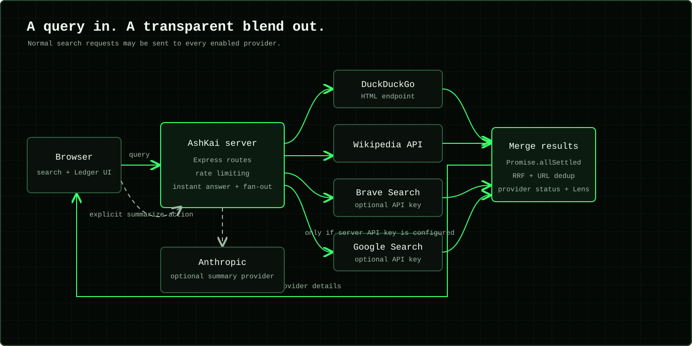
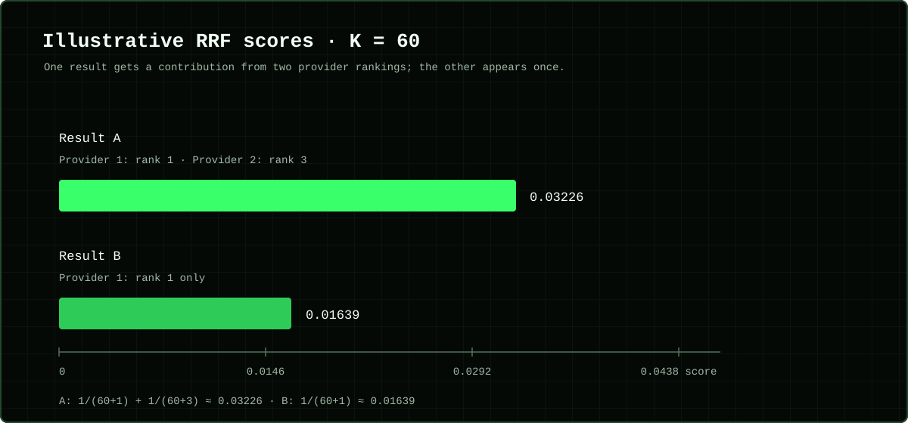

# AshKai — Private Meta-Search


**Search across independent engines. See how results are combined and understand the privacy trade-offs.**

AshKai is a self-hostable meta-search app built with Node.js, Express, and
plain HTML/CSS/JavaScript. Its server queries configured search providers
and merges their results into one ranked list, with per-engine details in
the Ledger.

AshKai does not persist queries in an application database or include them
in its request logs. Queries are sent to the providers enabled on your
instance, which may process or retain them under their own policies. The
server also handles client connection details in memory for rate limiting.
AshKai is privacy-oriented software, not an anonymity service.

## Watch the demo

[](docs/media/ashkai-demo.mp4)

The linked MP4 is included in [`docs/media/`](docs/media/). The preview
graphic is an illustration, not a screenshot.

## What AshKai does

### Search and inspect

- Queries DuckDuckGo and Wikipedia; optionally adds Brave Search and Google
  Programmable Search when configured.
- Combines results with Reciprocal Rank Fusion (RRF), strips common
  tracking parameters from result URLs, and shows provider status and
  unblended results in the Ledger.
- Supports bangs such as `!w graph theory`, local calculator and unit
  conversion answers, and a server-time answer.

### Keep browser data local

- No user accounts or browser cookies. Optional search history is kept in
  browser storage, encrypted with Web Crypto, and expires after 24 hours.
  Its key is stored alongside the encrypted data, so it is not protection
  against someone with access to your unlocked browser profile.
- Optional pinboard, custom bangs, vault-only autocomplete, panic wipe, and
  Wayback links are browser-side features.
- An opt-in cloaking toggle sends randomized decoy queries as well as the
  real query. It adds noise; it does not hide the real query.

### Extend and install

- Optional, user-requested Anthropic summaries use up to six result
  excerpts and URLs; they do not run automatically or affect ranking.
- The installable PWA caches its app shell for offline access. Search and
  summaries still require a connection; API responses are not cached.
- A small canvas runner game works offline once the app shell is available.

## How search works



Providers run independently so one failed engine does not prevent results
from the others. Calculator, conversion, and time answers are computed
locally, but the current server flow still sends those queries to
configured search providers. The query exposure score is also computed
after provider requests; it cannot prevent a query from being sent.

### Why rank fusion?

RRF adds a contribution of `1 / (60 + rank)` for each provider that returns
a result. This illustrative example uses one result at rank 1 and another
appearing at ranks 1 and 3; it explains the formula, not measured AshKai
search performance.



For implementation details and the repository map, see
[`docs/architecture.md`](docs/architecture.md).

## Run locally

**Requirements:** Node.js 18 or later and npm.

From the repository root:

```bash
cd backend
cp .env.example .env
npm install
npm start
```

If `backend/.env` already exists, keep it instead of copying over it. On
PowerShell, create a new file with `Copy-Item .env.example .env`. Open
<http://localhost:8787>; the backend serves the frontend. API keys are
optional for local development.

For automatic backend reloads, run `npm run dev` instead of `npm start`.

### Configuration

Optional settings are documented in [`backend/.env.example`](backend/.env.example).

| Variable | Purpose |
| --- | --- |
| `PORT` | Backend port; defaults to `8787`. |
| `BRAVE_API_KEY` | Enables Brave Search. |
| `GOOGLE_API_KEY` and `GOOGLE_CSE_ID` | Enable Google Programmable Search. |
| `ANTHROPIC_API_KEY` | Enables on-demand result summaries. |
| `ASHKAI_SUMMARY_MODEL` | Summary model override. |
| `ALLOWED_ORIGINS` | Comma-separated CORS origins for a separately hosted frontend. Blank allows any origin and is not authentication. |

### Docker Compose

Run from the repository root. Compose requires `backend/.env`; if it
already exists, keep your local settings.

```bash
cp backend/.env.example backend/.env
docker compose up --build
```

For a public deployment, use HTTPS and configure `ALLOWED_ORIGINS`. When
hosting the frontend separately, set `window.ASHKAI_API_BASE` in
[`frontend/config.js`](frontend/config.js) to the backend URL.

## Known limitations

- DuckDuckGo uses its HTML endpoint rather than an official API and may
  return no results when challenged or rate-limited. Optional Brave and
  Google integrations use their official APIs, with their own quotas and
  availability limits.
- The query exposure score is advisory and runs after provider requests.
  Local instant answers also currently go through the normal provider
  fan-out.
- Vault entries are pruned when the app reads the vault, not by a
  background timer while the app is closed. The local encryption key is
  stored in the same browser storage as the ciphertext.
- The repository has no automated test suite or license file yet. There
  is no hosted live instance; the demo video is provided in the repository.

## Project structure

```text
backend/       Express server and search-provider integrations
frontend/      No-build web app, PWA assets, and offline game
docs/
  architecture.md
  media/       Banner, demo video, and explanatory diagrams
ashkai/        Separate, divergent copy; not used by the root quickstart
```

## Contributing

Open an issue or pull request with reproduction steps and a focused
description of the change. Document any new external data flow and keep
privacy claims consistent with actual behavior.

## License

No license file is included. Ask the repository owner before redistributing
or reusing this project.
