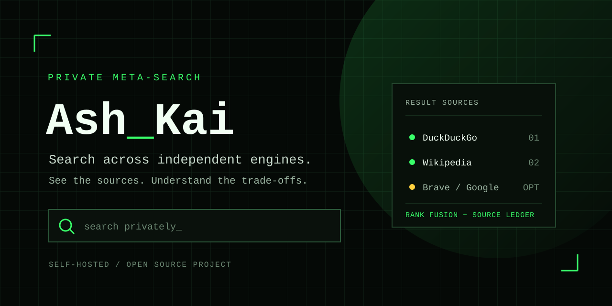

# AshKai — Private Meta-Search

**Search across independent engines, with the ranking and privacy trade-offs in view.**

AshKai is a self-hostable meta-search app. A browser sends a query to an
AshKai Node/Express server, which requests results from configured search
providers and combines them into one ranked list. A plain HTML/CSS/JavaScript
frontend needs no build step or framework.

AshKai does not write search queries to an application database or include
them in its request logs. The server does receive the query and client
connection details (the latter are used for in-memory rate limiting), then
forwards the query to the selected upstream providers. Those providers may
process or retain queries under their own policies. AshKai is a self-hosted
privacy-oriented search tool, not an anonymity service.

## Demo

[Watch the AshKai demo video (MP4)](docs/media/ashkai-demo.mp4).

## Features

- **No application query logs.** The server logs method, path, status, and
  timing without query strings or client IP addresses. The rate limiter uses
  client connection details in memory; the app does not persist them.
- **No user accounts or browser cookies.**
- **Server-side search requests.** The browser sends its query to the
  AshKai server rather than directly to the search engines. The server
  sends queries to DuckDuckGo and Wikipedia, plus Brave or Google when
  configured; those providers see the query and AshKai server's network
  address.
- **Tracking-parameter stripping.** `utm_*`, `fbclid`, `gclid`, `msclkid`
  and similar are stripped from every result URL before you see it.
- **Rate limiting** on both API routes, to keep one client from hammering
  upstream engines on everyone's behalf.
- **Bang shortcuts** (`!w query`, `!gh query`, `!yt query`, …) that jump
  straight to a site's own search.
- **Instant answers** for calculator expressions, unit conversions, and
  the time. AshKai computes these locally, but the current server handler
  also sends the query to configured providers; see the limitation below.
- **Rank fusion, not "pick one engine."** Results from every engine are
  merged with Reciprocal Rank Fusion (`backend/src/lib/fuse.js`), allowing
  agreement across engines to influence the combined ranking.
- **The Ledger.** Every search opens a small inspector panel showing
  which engines returned, failed, or returned no results, along with each
  engine's unblended top results.
- **A query exposure score.** AshKai checks for patterns such as an email,
  phone number, street address, or first-person medical/legal question and
  returns an advisory score with the results. It does not block or alter
  the query; the score is computed after the server has contacted providers,
  so it cannot prevent a sensitive query from being sent upstream.
- **A local, encrypted search vault.** Opt-in, off by
  default. If you turn it on, your recent searches are kept — AES-GCM
  encrypted — only in your own browser's `localStorage`, and every entry
  expires after 24 hours and is removed the next time the vault is read.
  The encryption key is stored in the same browser storage as the
  ciphertext, so this protects against casual inspection, not someone
  with access to your unlocked device. The server never sees the vault.
- **Optional one-click synthesis.** If you add your own Anthropic API
  key, clicking "Summarize top results" sends the query and up to six
  result excerpts and URLs to Anthropic for a short, source-cited
  summary. It does not run automatically or re-rank results.
- **Self-hosted fonts.** Even the typefaces are bundled as local `.woff2`
  files, so loading the page never pings Google Fonts.
- **An offline mini-game, always available.** Same genre as the browser's
  dino game (endless side-scrolling dodge), different world: a padlock
  outrunning "beacons" (jump) and "scanners" (duck) instead of cacti and
  pterodactyls. Pure canvas, zero dependencies, zero network calls — so
  it can be played offline after the app shell has been cached. High score
  saved locally. See `frontend/game.js`.
- **Installable PWA with an offline app shell.** `manifest.json` and
  `frontend/sw.js` cache the interface assets. The shell and mini-game can
  load offline after caching, but search and synthesis still require a
  connection; `/api/*` responses are never cached.
- **Query cloaking.** An opt-in toggle in the Ledger that fires 2–3
  randomized decoy searches alongside every real one. The real query is
  still sent unchanged; this adds noise but does not provide anonymity.
- **Panic wipe.** One button (or press Escape twice quickly) instantly
  clears the vault and pinboard and jumps back to the homepage. Built
  for a shared or borrowed computer moment, not a security boundary.
- **Your own custom bangs.** Define shortcuts like `!mypy` →
  `https://github.com/search?q={q}+language:python` in the hero page.
  Saved only in your browser and checked *before* a query ever reaches
  AshKai's server — a custom bang never touches the backend at all.
- **Local-only autocomplete.** Suggestions are drawn exclusively from
  your own encrypted vault, decrypted and filtered entirely client-side.
  If the vault's off or empty, there's nothing to suggest — every other
  provider's autocomplete is not queried as you type.
- **Search the past.** A Ledger toggle that opens results via the
  Wayback Machine's most recent snapshot instead of the live page. The
  archive is contacted only when you follow a result with this option
  enabled.
- **A local Pinboard.** Pin specific results with tags and export them as
  JSON. The pinboard is stored in browser `localStorage` and is not
  encrypted or synchronized.

## Architecture

See [the architecture guide](docs/architecture.md) for the repository
layout, request flow, and integration boundaries.

## Technology

- **Backend:** Node.js 18+, Express 4, Cheerio for DuckDuckGo's HTML results,
  and `express-rate-limit` for API throttling.
- **Frontend:** plain HTML, CSS, and JavaScript; no build step or frontend
  framework. Local storage and Web Crypto power browser-local features.
- **Deployment:** one Node process or the included Docker image and Compose
  file. The backend serves the root-level frontend assets.

## Quickstart (local)

Requires Node.js 18 or later and npm.
If `backend/.env` already exists, keep it; copy the example only when
creating a new local environment file.

```bash
cd backend
cp .env.example .env
npm install
npm start
```

Open **http://localhost:8787** — the backend serves the frontend itself,
so no separate frontend server is needed. The copied `.env` works without
optional API keys. Try a search, `!w graph theory`, `5 km to miles`, or
`12 * (7 + 3)`.

For auto-reload during backend development, run `npm run dev` instead of
`npm start`. In PowerShell, use `Copy-Item .env.example .env` for the
copy step.

## Configuration

All optional — AshKai works with zero API keys. See `backend/.env.example`:

| Variable | Effect |
|---|---|
| `PORT` | Backend port (default `8787`) |
| `BRAVE_API_KEY` | Adds Brave's independent index to the blend |
| `GOOGLE_API_KEY` + `GOOGLE_CSE_ID` | Adds Google's official Programmable Search API |
| `ANTHROPIC_API_KEY` | Enables the "Synthesize" button |
| `ASHKAI_SUMMARY_MODEL` | Model for synthesis (default `claude-haiku-4-5-20251001`) |
| `ALLOWED_ORIGINS` | Comma-separated browser origins allowed by CORS. Blank allows any origin; set this for a deployed frontend. This is not authentication. |

If you host the frontend separately from the backend, edit
`frontend/config.js` and set `window.ASHKAI_API_BASE` to your backend's
URL (without a trailing slash).

## Deployment

The backend serves the root-level `frontend/` directory when it is present.
Run the Node process from `backend/`, or use the repository's Docker setup.
Hosting provider pricing and availability vary.

- **Docker Compose** (from the repository root). Create the env file first,
  because Compose requires `backend/.env`. If it already exists, do not
  overwrite your local configuration:
  ```bash
  cp backend/.env.example backend/.env
  docker compose up --build -d
  ```
- **Node host or VPS**: use Node.js 18+, install dependencies from
  `backend/`, and start with `npm start`. For a public deployment, use
  HTTPS and set `ALLOWED_ORIGINS` to the frontend origin.

A video demo is included above; there is no hosted live instance or
separate screenshot gallery yet. Run the app locally to inspect the
interface yourself.

## Extending it

- **Add another engine:** create `backend/src/engines/yourengine.js`
  exporting an async function that returns `[{url, title, snippet}, ...]`,
  then add it to the `engineCalls` array in `server.js`. `fuseResults()`
  picks it up automatically.
- **Add a bang:** add one line to `BANGS` in `backend/src/lib/bangs.js`.
- **Change the fusion weighting:** `fuse.js`'s `K` constant controls how
  much the top of each engine's list dominates — lower it to trust
  top-ranked results more, raise it to flatten the blend.

## Known limitations, honestly

- DuckDuckGo's HTML endpoint isn't an official API — it's the same
  approach SearXNG and similar projects use. It can go quiet (return zero
  results with no error) if DuckDuckGo rate-limits or challenges the
  request, which can be more likely from a datacenter/cloud IP than from
  your own machine. The Ledger panel shows this honestly: an engine
  chip reading "no results" (amber) means it was reachable but came back
  empty — check the terminal running the server for a matching warning
  log. This is one possible reason for seeing only Wikipedia results.
  Adding `GOOGLE_API_KEY`/`GOOGLE_CSE_ID` or `BRAVE_API_KEY` enables an
  official API integration and avoids this particular HTML-scrape
  challenge; those providers have their own quotas and availability limits.
- The search vault's encryption key lives in the same browser storage as
  the data it protects (see the comment in `app.js`) — it guards against
  casual inspection, not against someone with access to your unlocked
  device. Expired entries are pruned the next time the vault is read; no
  background timer clears browser storage while the app is closed.
- No JavaScript-rendered engines are scraped (by design — server-side
  headless browsing is heavier, slower, and a bigger attack surface for
  very little relevance gain over the four sources already here).
- **Instant-answer privacy:** the server computes calculator, unit
  conversion, and time answers locally, but currently continues with the
  normal provider fan-out. Those queries are therefore still sent to
  configured search providers. The privacy score is also computed only
  after the provider requests. Treat sensitive queries accordingly; this
  README documents current behavior and does not change it.

## Development status

The features above are implemented in the root-level application. The
repository does not currently include an automated test suite. Useful
future work would be adding tests for rank fusion and privacy helpers,
avoiding provider requests for locally answerable queries, improving
provider health diagnostics, and publishing a verified demo.

## Contributing

For a bug report or focused improvement, open a GitHub issue or pull
request with reproduction steps and a description of the behavior
affected. Keep changes aligned with the existing privacy model and
document any new external data flow. The quickstart and architecture above
refer to the root-level app, not the separate `ashkai/` copy.

## License

No license file is currently included. Ask the repository owner before
redistributing or reusing this project; a license should be selected
before accepting external contributions.
