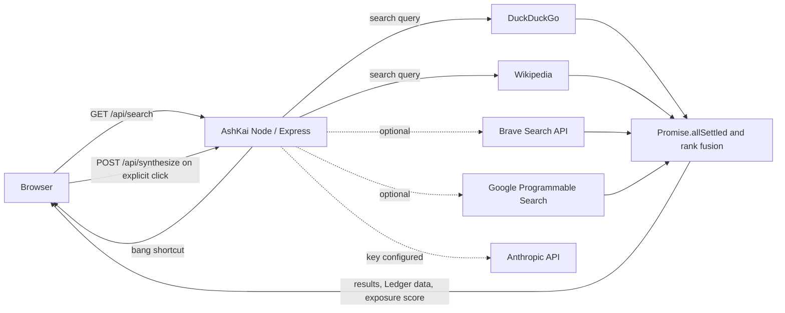

# AshKai architecture

The documented application lives in the repository-root `backend/` and
`frontend/` directories. The separate `ashkai/` directory contains a
divergent copy; the setup and deployment commands in the root README use
the root-level application.

## Repository layout

```text
.
├── backend/
│   ├── server.js
│   └── src/
│       ├── engines/          Search-provider integrations
│       └── lib/              Fusion, privacy helpers, bangs, answers, synthesis
├── frontend/                 HTML/CSS/JS, local fonts, PWA assets, mini-game
├── docs/
│   ├── architecture.md
│   └── media/                Repository banner and demo video
├── Dockerfile
├── docker-compose.yml
└── README.md
```

## Search request flow



Each search-engine call settles independently, so a failed provider does
not prevent results from the others. The frontend receives the fused
results and per-engine Ledger data. Optional synthesis sends the query and
result excerpts to Anthropic only when the user requests it and a server
API key is configured.

## Implementation boundaries

- `backend/server.js` wires routes, rate limits, and provider integrations.
- `backend/src/engines/` contains the DuckDuckGo, Wikipedia, Brave, and
  Google search adapters.
- `backend/src/lib/fuse.js` combines provider results and builds the
  per-engine Lens view.
- `backend/src/lib/privacy.js` strips tracking parameters and computes the
  advisory query exposure score.
- `backend/src/lib/instantAnswers.js` resolves calculator, conversion,
  and time answers locally. The current server flow still sends these
  queries to configured search providers.
- `frontend/` contains the no-build web app, browser-local features, PWA
  shell, and offline mini-game.

For setup, configuration, and known limitations, see the
[main README](../README.md).
